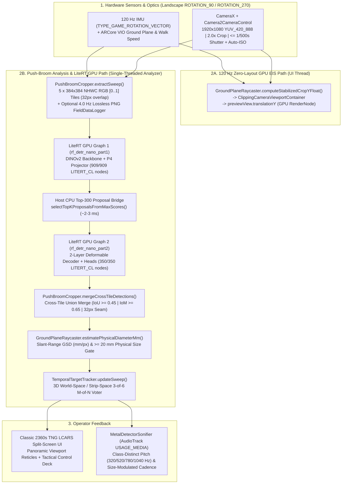

# GneissFind Developer Internals (`docs/INTERNALS.md`)

Welcome to the GneissFind engineering internals guide. This living document gives new contributors a clear mental model of how the Android sensor/AR/LiteRT pipeline and the Python ML export toolchain fit together, how to switch detector and graph configurations, how to run the test suites, and where to jump into the code for common tasks.

For historical postmortems and hardware benchmark tables, see [`docs/ENGINEERING_LEDGER.md`](ENGINEERING_LEDGER.md). For upcoming milestones, see [`docs/ROADMAP.md`](ROADMAP.md).

---

## Table of Contents
1. [Top-Level Architecture Overview](#1-top-level-architecture-overview)
2. [Repository Layout](#2-repository-layout)
3. [Setting & Switching Configurations](#3-setting--switching-configurations)
4. [Running the Tests & Benchmarks](#4-running-the-tests--benchmarks)
5. ["If You Want to Do X, Look in File Y at Class Z"](#5-if-you-want-to-do-x-look-in-file-y-at-class-z)
6. [Critical Hardware & Compiler Invariants ("Here Be Dragons")](#6-critical-hardware--compiler-invariants-here-be-dragons)
7. [Coding & Documentation Standards](#7-coding--documentation-standards)

---

## 1. Top-Level Architecture Overview

GneissFind operates as a **push-broom line scanner** rather than a full-frame video detector. While the operator walks across a gravel bar holding the phone in landscape at roughly a $45^\circ$ downward pitch (`~1.5 m` slant range), the app crops a horizontal strip across the `1920x1080` camera sensor (`1792x384 px`, partitioned into 5 overlapping `384x384` tiles) and shifts that strip vertically (`cropY in 0..696`) in real time using the 120 Hz gyroscope (`TYPE_GAME_ROTATION_VECTOR`) so the strip tracks the same ground patch despite wrist pitch wobble.



### Why Two Subgraphs for `RF-DETR-Nano`?
Standard single-graph `RF-DETR-Nano` exports emit `TOPK_V2` and `GATHER_ND` between the encoder proposal head and the 2-layer decoder. Android's OpenCL GPU delegate (`LITERT_CL`) rejects those two ops and drops all 404 downstream decoder nodes onto CPU XNNPACK (`8` partitions, `538 ms/sweep`). Splitting the model at the proposal-selection boundary allows **both** `Part 1` (`909/909` nodes) and `Part 2` (`350/350` nodes) to compile into **single-partition 100% GPU graphs**, with a zero-allocation Kotlin min-heap bridge (`~2–3 ms`) connecting them.

---

## 2. Repository Layout

```text
gneissfind/
├── android/                         # Android Studio / Gradle project (Kotlin, Jetpack Compose, LiteRT 2.x)
│   └── app/src/main/
│       ├── assets/                  # Staged .tflite models, rf_detr_coco_metadata.json
│       ├── java/com/gneissfind/app/
│       │   ├── MainActivity.kt      # Reversible sensorLandscape host, permissions, rotation listeners
│       │   ├── ar/                  # GroundPlaneRaycaster (IMU pitch EIS, ARCore VIO, GSD math)
│       │   ├── audio/               # MetalDetectorSonifier (zero-alloc PCM AudioTrack synthesizer)
│       │   ├── camera/              # PushBroomCameraController (Camera2 exposure) & PushBroomCropper
│       │   ├── data/                # FieldDataLogger (4.0 Hz lossless PNG strip + metadata.jsonl)
│       │   ├── inference/           # StoneDetector, RfDetrTwoGraphGpuDetector, SyntheticStoneDetector
│       │   ├── model/               # StoneModels.kt (StoneClass, StripRoiGeometry, NormalizedRect)
│       │   ├── tracking/            # TemporalTargetTracker (3-of-6 M-of-N multi-frame voter)
│       │   ├── ui/                  # ScannerScreen.kt, ScannerViewModel.kt, theme/LcarsComponents.kt
│       │   └── vision/              # PushBroomSweepBuffers, Yuv420Frame abstractions
│       └── res/font/                # Bundled offline Antonio font family (OFL-1.1)
├── ml-pipeline/                     # Python uv project (PyTorch, rfdetr, litert-torch, pytest)
│   ├── src/gneissfind_ml_pipeline/
│   │   ├── wrappers.py              # Rank-4 LITERT_CL-safe 1-graph & 2-graph PyTorch export wrappers
│   │   └── coco_oracle.py           # Empirical MS-COCO 91-logit stand-in verifier & metadata builder
│   ├── scripts/
│   │   ├── export_rfdetr_litert.py  # Exports 1G/2G B=1/B=5 .tflite files & stages Android assets
│   │   └── verify_coco_export.py    # Standalone CLI parity check against PyTorch
│   └── tests/                       # pytest suite + 384x384 COCO stand-in image fixtures
├── scripts/
│   ├── benchmark_pixel10.sh         # Automated ADB 4-way LiteRT GPU benchmark harness
│   └── pack_context.sh              # Bundles repo docs into /tmp/gneissfind-sync.md
└── docs/
    ├── INTERNALS.md                 # This developer onboarding & architecture guide
    ├── ENGINEERING_LEDGER.md        # Append-only hardware validation findings & benchmark tables
    ├── ROADMAP.md                   # Milestone specifications & acceptance criteria
    └── COMMENTING.md                # Purpose-first commenting standard
```

---

## 3. Setting & Switching Configurations

Detector backends, graph topologies (`two_graph` vs. `single_graph`), batch sizes (`B=5` vs. `5 x B=1`), and swath widths (`5-TILE` vs. `3-TILE`) can be configured at three levels:

### 3.1. Build / Export Time (Bundled APK Defaults)
`RfDetrTwoGraphGpuDetector` reads `android/app/src/main/assets/rf_detr_coco_metadata.json` on startup to determine which `.tflite` files and topology to load from `assets/`.

To change the default topology or batch size bundled into the APK, run `export_rfdetr_litert.py` from `ml-pipeline/`:

```bash
cd ml-pipeline

# Default production configuration: 2-Graph split, static B=5 batched (fastest on Pixel 10 Pro XL)
CUDA_VISIBLE_DEVICES=0 uv run python scripts/export_rfdetr_litert.py \
  --active-topology two_graph \
  --active-batch 5 \
  --skip-export

# Alternative: 2-Graph split, sequential B=1
CUDA_VISIBLE_DEVICES=0 uv run python scripts/export_rfdetr_litert.py \
  --active-topology two_graph \
  --active-batch 1 \
  --skip-export

# Alternative: 1-Graph fused, static B=5
CUDA_VISIBLE_DEVICES=0 uv run python scripts/export_rfdetr_litert.py \
  --active-topology single_graph \
  --active-batch 5 \
  --skip-export
```
> **Tip:** Omit `--skip-export` when you have modified `ml-pipeline/src/gneissfind_ml_pipeline/wrappers.py` and need `litert-torch` to re-trace and re-export all `.tflite` binaries into `ml-pipeline/artifacts/`.

### 3.2. In-App Runtime Controls (LCARS Tactical Control Deck)
While the app is running on device:
- **`SRC` Pill (`TNG Gold` in right column):** Tap to expand `LcarsSourceDrawerOverlay` over the control deck. Select between:
  - `RF-DETR-NANO GPU [COCO]` *(default live neural inference)*
  - `MIXED GRAVEL SIM` *(synthetic moving gravel bar with confusers)*
  - `20MM AGATE SIM` *(synthetic 20 mm pebble calibration target)*
  - `55MM JASPER SIM` *(synthetic 55 mm cobble calibration target)*
- **`SW` Pill (`5-TILE` / `3-TILE` Periwinkle toggle):** Switches between the full `5 x 384x384` (`1792x384 px`) swath and the narrower `3 x 384x384` (`1088x384 px`) center swath.
- **`MOD` Pill (`SCAN` / `LOG` on left stem):** Switches between live detection (`SCAN`) and `4.0 Hz` lossless PNG field strip logging (`LOG`).

### 3.3. ADB Hot-Swap Override (`benchmark_override.json`)
During development or automated benchmarking, you can switch LiteRT models and GPU options **without rebuilding the APK** by writing `/sdcard/Android/data/com.gneissfind.app/files/benchmark_override.json`. `RfDetrTwoGraphGpuDetector.checkBenchmarkOverrideHotSwap()` checks the file's `lastModified` timestamp on every sweep and reloads the LiteRT environment automatically when it changes.

Example: hot-swap to `2-Graph B=5` pushed to `/sdcard/Android/data/com.gneissfind.app/files/`:
```bash
adb shell 'cat <<EOF > /sdcard/Android/data/com.gneissfind.app/files/benchmark_override.json
{
  "topology": "two_graph",
  "batch_size": 5,
  "active_tiles": 5,
  "part1_path": "/sdcard/Android/data/com.gneissfind.app/files/rf_detr_nano_part1_b5.tflite",
  "part2_path": "/sdcard/Android/data/com.gneissfind.app/files/rf_detr_nano_part2_b5.tflite"
}
EOF'
```

Supported keys in `benchmark_override.json`:
- `"topology"`: `"two_graph"` or `"single_graph"`
- `"batch_size"`: `5` or `1`
- `"active_tiles"`: `5` or `3` (overrides UI `SW` tile count when present)
- `"part1_path"`, `"part2_path"`: absolute device paths for 2-graph `.tflite` files
- `"single_graph_path"`: absolute device path for 1-graph `.tflite` file
- `"prefer_texture_weights"`: `true` or `false`
- `"constant_tensor_sharing"`: `true` or `false`
- `"buffer_storage_type"`: `"default"`, `"buffer"`, or `"texture_2d"`

To return to the APK's bundled default configuration, delete the override file:
```bash
adb shell rm -f /sdcard/Android/data/com.gneissfind.app/files/benchmark_override.json
```

---

## 4. Running the Tests & Benchmarks

### 4.1. Android Unit Tests (JVM)
Runs cropper geometry, cross-tile `IoU`/`IoM`/seam union merging, COCO metadata parsing, Host `Top-300` min-heap selection, 3-of-6 temporal voter, LCARS viewport scaling, and `AudioTrack` waveform synthesis tests (`16` tests):
```bash
./android/gradlew -p android testDebugUnitTest
```

### 4.2. Python ML Export & Parity Tests (`pytest`)
Verifies separable bilinear matmul grid sampling against `F.grid_sample`, 1-graph vs. 2-graph PyTorch equivalence, `LITERT_CL` operator cleanliness (zero `TOPK_V2`, `GATHER_ND`, `BROADCAST_TO`, `FLOOR_DIV`, `RELU_0_TO_1`, and tensor rank $\le 4$), `B=5` vs. `5 x B=1` parity, and empirical COCO class IDs (`cup=47`, `apple=53`, `toothbrush=90`, `remote=75`) (`6` tests):
```bash
cd ml-pipeline
CUDA_VISIBLE_DEVICES=0 uv run pytest -v
```

### 4.3. On-Device Pixel 10 Pro XL Benchmark Matrix (`adb`)
Pushes all 6 exported `.tflite` files to a connected physical Android device, runs isolated process benchmarks across all configurations with thermal cooldowns, writes `ml-pipeline/artifacts/pixel10_benchmark_report.json`, and prints a Markdown comparison table:
```bash
./scripts/benchmark_pixel10.sh --warmup 2 --sweeps 12 --cooldown 8
```

---

## 5. "If You Want to Do X, Look in File Y at Class Z"

Use this lookup table as a starting point when navigating or modifying the codebase:

| If you want to... | Look in File (`Y`) | At Class / Function (`Z`) |
| :--- | :--- | :--- |
| **Change tile dimensions, `xOffsets`, or `32 px` overlap geometry** | `android/app/src/main/java/com/gneissfind/app/model/StoneModels.kt` | `StripRoiGeometry` (`TILE_Offsets_5`, `TILE_OFFSETS_3`, `NOMINAL_CROP_Y_PX`) |
| **Modify YUV-to-RGB tile extraction or cross-tile seam merging (`IoU` / `IoM`)** | `android/app/src/main/java/com/gneissfind/app/camera/PushBroomCropper.kt` | `PushBroomCropper.extractSweep` & `PushBroomCropper.mergeCrossTileDetections` |
| **Adjust the `<= 1/500 s` shutter clamp, floating ISO luma servo, or `2.0x` zoom** | `android/app/src/main/java/com/gneissfind/app/camera/PushBroomCameraController.kt` | `PushBroomCameraController.applyDynamicCameraControls` & `maybeServoFloatingIsoFromCenterLuma` |
| **Tune 120 Hz IMU pitch stabilization (`cropY`) or GSD (`mm/px`) raycasting** | `android/app/src/main/java/com/gneissfind/app/ar/GroundPlaneRaycaster.kt` | `GroundPlaneRaycaster.computeStabilizedCropYFloat` & `estimatePhysicalDiameterMm` |
| **Inspect or modify LiteRT GPU initialization, shader caching, or Host `Top-300` gather** | `android/app/src/main/java/com/gneissfind/app/inference/RfDetrTwoGraphGpuDetector.kt` | `RfDetrTwoGraphGpuDetector.ensureInitializedOnAnalyzerThread`, `detectSweep`, & `selectTopKProposalsFromMaxScores` |
| **Change how COCO class IDs map to the 4 mineral targets + `HARD_CONFUSER`** | `ml-pipeline/src/gneissfind_ml_pipeline/coco_oracle.py` & `android/app/src/main/assets/rf_detr_coco_metadata.json` | `STAND_IN_SPECS`, `build_coco_metadata`, & `RfDetrTwoGraphGpuDetector.parseCocoMetadataJson` |
| **Modify the PyTorch-to-LiteRT graph split or fix an unsupported GPU delegate op** | `ml-pipeline/src/gneissfind_ml_pipeline/wrappers.py` | `RfDetrPart1BackboneEncoder`, `RfDetrPart2DecoderHead`, `bilinear_matmul_grid_sample`, & `_gpu_rank4_*` |
| **Adjust the 3-of-6 multi-frame persistence filter or spatial association radius** | `android/app/src/main/java/com/gneissfind/app/tracking/TemporalTargetTracker.kt` | `TemporalTargetTracker.updateSweep` |
| **Change stone ping frequencies (`320/520/780/1040 Hz`), harmonic envelope, or cadence** | `android/app/src/main/java/com/gneissfind/app/audio/MetalDetectorSonifier.kt` | `MetalDetectorSonifier.updateTargets` & `synthesizePingBurst` |
| **Edit the split-screen LCARS HUD, panoramic viewport crop, or inline source drawer** | `android/app/src/main/java/com/gneissfind/app/ui/ScannerScreen.kt` | `ScannerScreen`, `PanoramicViewportZone`, `ClippingCameraViewportContainer`, & `TacticalControlDeckZone` |
| **Modify the 6-role LCARS semantic color palette or swept elbow geometry** | `android/app/src/main/java/com/gneissfind/app/ui/theme/Theme.kt` & `LcarsComponents.kt` | `LcarsSemanticColors`, `LcarsPalette`, & `LcarsElbowShape` |
| **Wire UI state transitions or background analyzer frame orchestration** | `android/app/src/main/java/com/gneissfind/app/ui/ScannerViewModel.kt` | `ScannerViewModel.processSweepFrame` & `ScannerUiState` |
| **Inspect `4.0 Hz` lossless PNG field strip logging for SAM 2 training** | `android/app/src/main/java/com/gneissfind/app/data/FieldDataLogger.kt` | `FieldDataLogger.maybeLogStrip` & `FieldStripMetadata` |

---

## 6. Critical Hardware & Compiler Invariants ("Here Be Dragons")

Before touching camera binding, custom View containers, or PyTorch export wrappers, read these hard-won hardware invariants (documented in full in [`docs/ENGINEERING_LEDGER.md §3.4–§3.5`](ENGINEERING_LEDGER.md)):

1. **Never skip `previewView.measure()` / `previewView.layout()` inside `ClippingCameraViewportContainer.onLayout` (`ScannerScreen.kt`):**
   - `PreviewView` (`ImplementationMode.COMPATIBLE`) adds its internal `TextureView` child asynchronously when CameraX binds the session. If the parent `ViewGroup` caches outer dimensions and skips measuring/laying out `previewView` on subsequent `onLayout` passes, the `TextureView` stays at `0x0`, `SurfaceRequest` never completes, and the entire Camera2 session (`Preview` + `ImageAnalysis`) stalls on a black screen. Keep 120 Hz EIS translation strictly on `previewView.translationY`.
2. **Never set static AE options on `Camera2Interop.Extender` (`PushBroomCameraController.kt`):**
   - Options set on `Camera2Interop.Extender(analysisBuilder)` carry `OptionPriority.ALWAYS_OVERRIDE` in CameraX 1.4 and permanently block runtime changes submitted via `Camera2CameraControl.setCaptureRequestOptions(...)`. Drive manual shutter speed (`SENSOR_EXPOSURE_TIME <= 2,000,000 ns`) and `SENSOR_SENSITIVITY` exclusively through `Camera2CameraControl`.
3. **Never introduce rank $\ge 5$ tensors, `BROADCAST_TO`, `FLOOR_DIV`, `RELU_0_TO_1`, `TOPK_V2`, or `GATHER_ND` into `RfDetrPart1BackboneEncoder` or `RfDetrPart2DecoderHead` (`wrappers.py`):**
   - Android's OpenCL GPU delegate (`LITERT_CL`) rejects any tensor with rank $> 4$ (`Tensor dimensions must be less than 5`), rejects `BROADCAST_TO` (use `torch.cat` along `dim=0`), rejects `FLOOR_DIV` and `RELU_0_TO_1` (use `F.relu(x) - F.relu(x - 1.0)`), and rejects OpenCL 2D textures with width/height $> 16384$ (`clCreateImage: Invalid image size`). Run `uv run pytest -k test_two_graph_tflite_eliminates_topk_and_gather_nd` after any model wrapper edit.

---

## 7. Coding & Documentation Standards

- **Commenting Standard:** All Kotlin and Python files follow the purpose-first commenting standard in [`docs/COMMENTING.md`](COMMENTING.md). Every source file begins with a file header comment stating its responsibility and key collaborators, and non-trivial public classes/functions carry KDoc/docstrings explaining behavior, units, and invariants.
- **Zero Per-Frame Allocations on Hot Paths:** `PushBroomCropper`, `PushBroomSweepBuffers`, `RfDetrTwoGraphGpuDetector.detectSweep`, and `MetalDetectorSonifier` must reuse pre-allocated arrays/buffers on every frame so garbage collection never pauses the 120 Hz EIS or audio threads.
